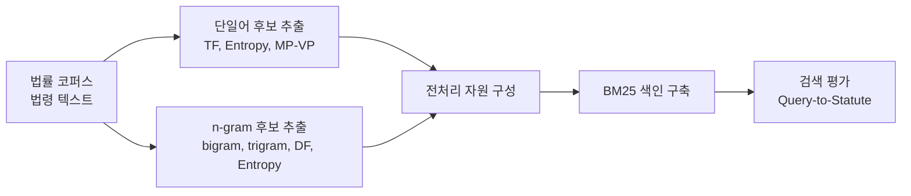

# 논문 그림 초안 모음

> 논문 본문에 들어갈 도식, Mermaid 초안, 그림 배치 메모를 모아두는 작업 파일
> 최종 업데이트: 2026-04-22

---

## 그림 1. 법령 검색 실험을 위한 전처리 파이프라인 개요

추천 배치:
- 제3장 방법론
- `3.4 최종 전처리 세트 구성 및 평가 설계` 시작부 또는 직후

설명 메모:
- 법령 코퍼스에서 단일어 후보 추출과 n-gram 후보 추출이 병렬로 이루어지고,
- 이들이 전처리 자원으로 결합된 뒤,
- BM25 색인 구축과 Query-to-Statute 평가로 이어지는 흐름을 도식화한 그림



본문 연결 문장 예시:

```text
그림 1은 본 연구의 법령 검색 실험을 위한 전처리 파이프라인을 요약한 것이다. 법령 코퍼스로부터 단일어 후보와 n-gram 후보를 병렬적으로 생성한 뒤, 이를 전처리 자원으로 구성하여 BM25 색인과 검색 평가에 적용하였다.
```

### SVG/PNG 제작용 도식 문안

그림 목적:
- 법령 코퍼스에서 단일어 기반 후보 생성과 n-gram 기반 구문 필터링이 병렬적으로 수행되고,
- 두 결과가 전처리 자원으로 통합된 뒤,
- BM25 색인과 Query-to-Statute 평가로 이어지는 전체 흐름을 한눈에 보여주는 것

권장 레이아웃:
- 좌에서 우로 흐르는 가로형 파이프라인
- 시작 노드 1개, 중간 병렬 노드 2개, 통합 노드 1개, 적용 노드 1개, 평가 노드 1개
- 총 6개 박스 구성

박스 문구:
1. `법률 코퍼스`
   - 부제: `법령 텍스트`
2. `단일어 후보 생성`
   - 부제: `TF, Entropy, MP-VP`
3. `n-gram 후보 생성`
   - 부제: `bigram, trigram, DF, Entropy`
4. `전처리 자원 구성`
   - 부제: `단일어 후보군 + n-gram 구문 필터`
5. `BM25 색인 구축`
6. `검색 평가`
   - 부제: `Query-to-Statute`

화살표 연결:
- `법률 코퍼스` → `단일어 후보 생성`
- `법률 코퍼스` → `n-gram 후보 생성`
- `단일어 후보 생성` → `전처리 자원 구성`
- `n-gram 후보 생성` → `전처리 자원 구성`
- `전처리 자원 구성` → `BM25 색인 구축`
- `BM25 색인 구축` → `검색 평가`

디자인 메모:
- 입력(`법률 코퍼스`)은 연한 회색
- 후보 생성 단계(`단일어 후보 생성`, `n-gram 후보 생성`)는 같은 계열의 옅은 파란색
- 통합 단계(`전처리 자원 구성`)는 조금 더 진한 파란색 또는 청록색
- 적용 및 평가 단계(`BM25 색인 구축`, `검색 평가`)는 연한 녹색 계열
- 모든 박스는 둥근 사각형으로 통일
- 화살표는 단방향 실선으로 처리
- 부제는 본문보다 작은 글씨로 넣고, 줄바꿈은 2줄 이내로 유지

HWP 삽입용 그림 캡션 초안:

```text
그림 1. 법령 검색 실험을 위한 전처리 파이프라인 개요
법령 코퍼스로부터 단일어 후보와 n-gram 후보를 병렬적으로 생성한 뒤, 이를 전처리 자원으로 통합하여 BM25 색인 구축과 Query-to-Statute 평가에 적용한 절차를 나타낸다.
```

간단 도식 스케치:

```text
[법률 코퍼스: 법령 텍스트]
          ├────────→ [단일어 후보 생성: TF, Entropy, MP-VP] ───────┐
          └────────→ [n-gram 후보 생성: bigram, trigram, DF, Entropy] ─┤
                                                                         ↓
                                                     [전처리 자원 구성: 단일어 후보군 + n-gram 구문 필터]
                                                                         ↓
                                                              [BM25 색인 구축]
                                                                         ↓
                                                         [검색 평가: Query-to-Statute]
```
